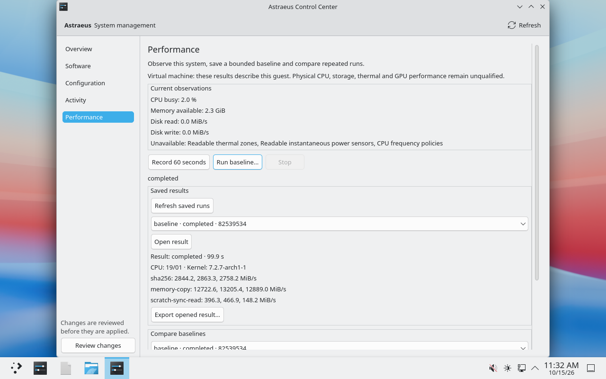

# Phase 5.0 performance baselines and diagnostics

Status: VM acceptance passed, awaiting review. Accepted source:
`c38209c523e308d23ff622b32d9cd0ed42682962`. PR #13 remains draft and unmerged,
stacked on the Phase 4.2 branch. This is development acceptance on x86-64
UEFI/QEMU/KVM, not a stable release or physical-machine qualification.
[Gate record](evidence/phase5-build-c38209c/acceptance.json).

## Clean builds and installed acceptance

A and B built independently on separate validators, each with its own 64 GiB
disk. B consumed A's exact signed repository after whole-archive and signature
verification, and started before A finished its ISO. Both builder disks remain
retained. An actual full-file `cmp` passed, separately from the comparison of all
five independently compiled package archives. Both ISOs are 3,785,349,120 bytes,
SHA256 `174197f2878e8bb03ddef517878550ebfa4f16ede30a50c177c06a905fac0c6c`.
[Byte and package comparison](evidence/phase5-build-c38209c/comparison.json),
[parallel-builder provenance](evidence/phase5-build-c38209c/comparison-cross-host.json).

The image audit checked the frozen source inputs, actual packaged binaries,
signatures, embedded repository and ownership inputs, complete live/installed
package manifests, and private signing material. The independently built Qt
suites passed 22/22 controller, 13/13 performance and 16/16 QML cases on each
builder. No skips were accepted.
[Image audit](evidence/phase5-build-c38209c/audit-A.json),
[A tests](evidence/phase5-build-c38209c/build-A/control-center-LastTest.log),
[B tests](evidence/phase5-build-c38209c/build-B/control-center-LastTest.log).

Separate plain and LUKS2 validators installed the fresh candidate through the
production provisioner and passed two enforcing cold boots, maintained UKI
verification and actual SDDM/Plasma Wayland logins. Installation used the approved
SetupMode bootstrap. Installed management and recovery tests required
SecureBoot=1 and SetupMode=0. This run does not claim Calamares GUI installation.
[Plain installation](evidence/phase5-build-c38209c/plain/installation/baseline.json),
[LUKS2 installation](evidence/phase5-build-c38209c/luks2/installation/baseline.json).

Both ordinary-user production CLI suites passed real collection, two bounded
baselines, exact stored/show/export equality, compatible comparison, passive
comparison refusal, concurrency refusal, durable SIGTERM cancellation, bounded
arguments, private owned state and scratch cleanup.
[Plain CLI](evidence/phase5-build-c38209c/plain/desktop/cli.json),
[LUKS2 CLI](evidence/phase5-build-c38209c/luks2/desktop/cli.json).

## Native desktop and management interactions

Both native desktops completed a full baseline, exported through the native save
dialog with exact JSON equality, and compared distinct completed baselines.
Space activated the review's focused OK button, Stop received keyboard focus,
and focus returned to Record. Normal recording closure saved cancellation.
With an unapplied draft, cancelling Close kept the baseline advancing; confirming
Discard closed the app and saved cancellation. SIGKILL during an actual unnamed
scratch-file workload stopped the backend and saved cancellation without named
scratch residue. The GUI displayed the specific backend refusal when another
measurement held the user's lock.
[Plain export/close proof](evidence/phase5-build-c38209c/plain/desktop/native-export-and-confirmed-close.json),
[LUKS2 export/close proof](evidence/phase5-build-c38209c/luks2/desktop/native-export-and-confirmed-close.json),
[plain forced death](evidence/phase5-build-c38209c/plain/desktop/forced-gui-death.json),
[LUKS2 forced death](evidence/phase5-build-c38209c/luks2/desktop/forced-gui-death.json).

Before management fixtures, exact before/after observations matched across all
17 protected fields on both layouts: packages, reasons, configuration, ownership,
lock data, snapshots, history, firmware, UKIs and the personal-file sentinel.
[Plain proof](evidence/phase5-build-c38209c/plain/desktop/protected-state-unchanged.json),
[LUKS2 proof](evidence/phase5-build-c38209c/luks2/desktop/protected-state-unchanged.json).

Real configuration-only transactions stopped active baselines with an explicit
management reason; passive recordings completed during management and while a
reboot was pending. Metadata transactions required pre/post snapshots and a
signed UKI, then succeeded after a new enforcing boot. Both automatic boot
services actually executed successfully. An exclusive, inode-checked test pacman
lock blocked baselines while allowing passive recording; only that fixture's
own lock was removed.
[Plain management](evidence/phase5-build-c38209c/plain/desktop/requests/0013.result),
[plain metadata confirmation](evidence/phase5-build-c38209c/plain/desktop/requests/0016.result),
[LUKS2 management](evidence/phase5-build-c38209c/luks2/desktop/requests/0011.result),
[LUKS2 metadata confirmation](evidence/phase5-build-c38209c/luks2/desktop/requests/0013.result).

On each layout, cancelling the real KDE administrator prompt submitted no
transaction. Subsequent authentication applied the reviewed kcalc/libmpc install
through the production worker. A guarded PostTransaction signing-key fault left
the committed transaction in `rollback_required`, with baselines blocked and
passive recording still available. The encrypted worker was held after actual
package commit: closing the GUI left the same worker applying, and reopening
reconnected to it. A passive recording completed through barrier release and
signing failure. These fault clones were shut down and retained for inspection;
no online repair was attempted.
[Worker survives GUI closure](evidence/phase5-build-c38209c/luks2/desktop/requests/0019.result),
[plain signing failure](evidence/phase5-build-c38209c/plain/desktop/requests/0020.result),
[LUKS2 signing failure](evidence/phase5-build-c38209c/luks2/desktop/requests/0021.result).

## Restored-root carry-forward

The mandatory `awaiting-boot-restore` case passed on both layouts using the frozen
production validator. Each performed a real update awaiting boot, booted its
signed recovery companion with enforcement, restored the pre-update root
offline, and booted that root. Both `astraeus-confirm-boot` and
`systemd-bless-boot` executed with code 1, status 0 and nonzero current-boot
timestamps. The complete pending record, events and absent confirmation remained
unchanged. Explicit `finalize-rollback` then verified the restored packages,
reasons, configuration, ownership, lock and personal file and marked it rolled
back on the distinct boot.
[Plain matrix](evidence/phase5-build-c38209c/plain/recovery/matrix.json),
[plain automatic pending proof](evidence/phase5-build-c38209c/plain/recovery/automatic-restored-pending.json),
[LUKS2 matrix](evidence/phase5-build-c38209c/luks2/recovery/matrix.json),
[LUKS2 automatic pending proof](evidence/phase5-build-c38209c/luks2/recovery/automatic-restored-pending.json).

These focused matrices report `requested_run_passed: true`; their generic
`qualified: false` field intentionally does not qualify the whole Phase 4.2 fault
matrix. The original full Phase 4.2 acceptance remains tied to its recorded
source. Both signed live desktops also refused baselines, allowed passive
recording and stopped it with Space.

## Evidence, cost and limits

All four desktop/recovery public exports passed secret scanning and local
verification of every member's count, size and SHA256. Full archives remain with
the candidate images outside Git. Curated evidence and its
[hash manifest](evidence/phase5-build-c38209c/manifest.json) are committed here.
Both builders and both installation validators are paused, with original,
superseded and failed disks retained. No billing plan changed.

The conservative Phase 5 compute and active-storage estimate is **$6.72**,
separate from Phase 4.2. It excludes network and paused storage. The user lifted
the original $10 cap for parallel builders; the recorded estimate stayed below
that amount. [Ledger](evidence/phase5-build-c38209c/budget.json).

Bare-metal comparison and small kernel-related memory differences remain covered
by `bare_metal_and_kernel_memory_changes_remain_comparable` unit tests only.
Physical PC/USB/GPU tests, full GameMode self-test, tuning, sustained stress and
production signing qualification remain deferred. No physical performance or
performance improvement is claimed.

## Preserved unsuccessful attempts

The first c382 installation attempts timed out downloading the pre-existing tree
fixture after production provisioning, before signing/enrollment. Their disks
and errors remain preserved. Fresh blank retries used only the package matching
the current pinned repository hash and verified official signature in the
ordinary pacman cache; package/signature checks stayed enabled. A's first
evidence collector also failed on an absent optional sequential-build cache
directory. The build itself had passed; correcting that export-only assumption
did not change either candidate.
[Network failures](evidence/phase5-build-c38209c/network-fixture-failures),
[signed cache provenance](evidence/phase5-build-c38209c/tree-fixture/metadata.json),
[collector failure](evidence/phase5-build-c38209c/collector-first-attempt-A/failure.json).

Three read-only observation errors in the plain desktop harness are retained:
two polls omitted valid transient worker phases, and one module import lacked
its sibling directory. Corrected observers inspected the same operation and
passed. They did not resubmit the transaction or change runtime assertions.
The [gate record](evidence/phase5-build-c38209c/acceptance.json) identifies each.

The superseded `08713df` builds were reproducible but failed required production
CLI and restored-root gates. They must not be accepted.

The independent builds used source
`08713dfa7f2096217710ef4f6311e2d6bb264db5`. B ran on a separate validator with its
own 64 GiB disk and consumed A's verified signed repository. The complete
3,785,316,352-byte ISOs passed an actual byte comparison, with SHA256
`cf5f3d557d5078e7622731b27aa0b5ed1909cc9716afa39de31ae6b478f110c5`.
All five independently compiled package archives, source inputs, repository
contents and package manifests also matched. Both builder disks remain retained
and both builders are paused. [Comparison proof](evidence/phase5-build-08713df/comparison.json).

Separate plain and LUKS2 VMs passed fresh candidate-payload installation through
the production provisioner, then two cold boots with Secure Boot enforced,
maintained UKI verification and actual SDDM/Plasma Wayland logins. This does not
claim Calamares GUI installation. The installer used the approved SetupMode
bootstrap; all installed tests required SecureBoot=1 and SetupMode=0.
[Plain result](evidence/phase5-build-08713df/p5p-result.json) and
[LUKS2 result](evidence/phase5-build-08713df/p5e-result.json).

Both ordinary-user CLI suites completed their two real baselines, then failed
because reading saved JSON changed some floating-point values. For example,
`13.165680473372781` became `13.16568047337278`. Protected OS state stayed unchanged.
The correction enables the JSON parser's exact float round-trip feature and adds
the observed values to the existing storage regression. That regression fails
before the correction and passes afterward; Windows workspace tests, Linux
`distroctl` tests and Clippy on both platforms pass.
[Failure and correction evidence](evidence/phase5-json-roundtrip/proof.json).
Acceptance assertions remained unchanged. The replacement c382 builds and
production VM acceptance above passed; `08713df` must not be accepted.

The earlier `4788cb2` clean build failed when Arch's remapped compiler paths
prevented a controller test from locating `Main.qml`. Its
[build log](evidence/phase5-build-4788-failed/build.log),
[Qt log](evidence/phase5-build-4788-failed/control-center-LastTest.log) and
[controlled correction proof](evidence/phase5-build-4788-failed/remapped-path-proof.json)
remain preserved. All 20 public export members were verified before retiring
that closed failed builder disk.

Validation commit `1063ce8` adds the `awaiting-boot-restore` recovery case. It
requires a real update, signed offline restoration before confirmation, successful
automatic `astraeus-confirm-boot` and `systemd-bless-boot` execution, an unchanged
pending transaction and explicit rollback finalization. The LUKS2 case reached a
real update and signed offline restoration, then failed because
`systemd-bless-boot.service` was not requested on the restored non-counted entry.
`astraeus-confirm-boot` executed successfully. A success property with zero
execution timestamps did not satisfy the blessing-service gate; explicit
finalization was not reached. All 417 public failure files were exported and
verified before pausing the LUKS2 validator. Its disks remain retained.

The correction requests the blessing service from Astraeus confirmation,
orders it after the graphical target to preserve boot-health ordering, and keeps
the same history-presence and live-session guards. The pinned systemd verifier
accepts the graph with and without its optional boot-health checker. Windows and
Linux workspace tests, Clippy and the existing recovery harness tests pass. This
was the static and unit evidence before replacement acceptance. Both corrected
packaged cold-boot cases now passed as recorded above.
[Recovery failure and static verification](evidence/phase5-restored-root-startup/matrix.json).

The plain installed GUI completed a 99.2-second baseline and exported through the
native file dialog. The export matched the production backend. With an unapplied
MangoHud draft, cancelling Close left the baseline advancing; confirming Discard
closed the application and persisted a cancelled 51.7-second baseline. Space
activated the review's focused OK button; Enter did not. The signed live GUI
blocked baselines, allowed passive recording and stopped it with Space. These
observations do not override the CLI and recovery failures.

Bare-metal detection and memory-tolerant comparison
remain covered by `bare_metal_and_kernel_memory_changes_remain_comparable` unit
tests only. No physical-machine comparison is claimed.

Base: `abe83d078e25cf14b083ae6410953e6a78b695aa`, production Phase 4.2 runtime
`ec3641b72ad48d0ed24d4d9c8aa1a39cce938025`. PR #8 remains draft and unmerged.

The targeted Phase 4.2 closeout inspection checked conservative ownership
reconciliation, package-lock/snapshot integration, bounded submission validation,
and management/reboot identity against their existing regression and exported VM
evidence. No runtime change was required by this inspection. This is not a new
independent security audit. Its final Windows/Linux CI passed. Historical failure
evidence and physical qualification limits remain intact.

Phase 5.0 adds unprivileged observations, bounded CPU/memory/scratch-file workloads,
private saved results, honest comparisons, and a native Performance page. It does
not change governors, drivers, sysctls, package state or signing policy.

Required gates: portable Rust and Clippy; Linux collection/storage/workload tests;
Qt controller and QML tests; packaging/source tests; two independent identical
candidate images; ordinary-user plain/LUKS2 enforcing CLI/GUI acceptance, stop and
closure, missing sensors, management conflicts and unchanged OS state.

The final c382 evidence, paused validator state, cost and unresolved physical
qualification limits are recorded above.
